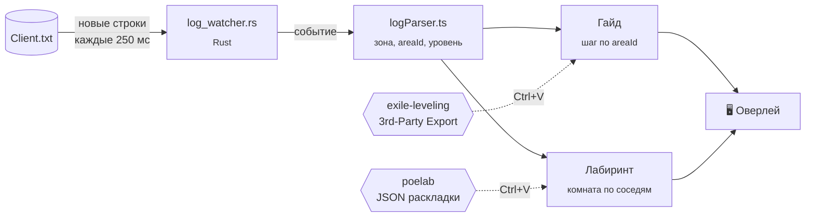

<div align="center">

# 🗺️ PoE Overlay

**Лёгкий оверлей для Path of Exile 1: маршрут по актам и навигация по лабиринту прямо поверх игры**

[](https://tauri.app)
[](https://www.typescriptlang.org)
[](https://www.rust-lang.org)
[](#-установка)
[](https://www.pathofexile.com)

[Возможности](#-возможности) •
[Установка](#-установка) •
[Использование](#-использование) •
[Управление](#%EF%B8%8F-управление) •
[Разработка](#%EF%B8%8F-разработка) •
[FAQ](#-faq)

</div>

---

## ✨ Возможности

<table>
<tr>
<td width="50%" valign="top">

### 🧭 Маршрут по актам
- Все **10 актов** по маршруту [exile-leveling](https://heartofphos.github.io/exile-leveling/)
- **Сам переключает шаг** при входе в зону
- Квесты, боссы, вейпоинты, трайлы, направления (↗ ←)
- **Гемы под твой билд** из Path of Building
- Не сбивается от портала в город за покупками

</td>
<td width="50%" valign="top">

### 🏛️ Лабиринт
- **Мини-схема** раскладки на сегодня с [poelab](https://www.poelab.com)
- Определяет **текущую комнату** по логу
- Подсказывает выход: **«↗ NE → Mansion Halls»**
- Кратчайший путь до Izaro, даркшрайны, тайные проходы
- Normal · Cruel · Merciless · Uber

</td>
</tr>
</table>

**А ещё:**

- 🪶 **Лёгкий.** Tauri вместо Electron: установщик в несколько мегабайт, мало памяти
- 🖱️ **Клики проходят сквозь окно**, игре оверлей не мешает
- 🌍 **Работает с любым языком клиента.** Зоны распознаются по внутреннему ID, а не по названию
- 💾 Запоминает маршрут, текущий шаг, раскладки лабы и положение окна
- 🔔 Иконка в трее

> [!IMPORTANT]
> **Безопасен для аккаунта.** Оверлей только читает лог-файл `Client.txt`: так же работают Exile-UI, Lailloken UI и LabCompass.
> Он **не читает память игры**, **не нажимает клавиши за тебя** и не вмешивается в процесс PoE.

---

## 📦 Установка

### Готовый установщик

1. Скачай `PoE Overlay_x.y.z_x64-setup.exe` из [Releases](../../releases)
2. Запусти. Права администратора не нужны, установка идёт только для текущего пользователя
3. Переключи PoE в режим **Windowed Fullscreen** (`Options → Graphics → Display Mode`)

> [!NOTE]
> В эксклюзивном полноэкранном режиме (`Fullscreen`) Windows не показывает окна поверх игры.

### Из исходников

<details>
<summary>Требования и сборка</summary>

| Что нужно | Где взять |
| --- | --- |
| Node.js 20+ | https://nodejs.org |
| Rust (stable) | https://rustup.rs |
| MSVC Build Tools | Visual Studio Installer → «Desktop development with C++» |
| WebView2 | Уже есть в Windows 10/11 |

```bash
git clone <url-репозитория>
cd poe-overlay
npm install
npm run installer   # → src-tauri/target/release/bundle/nsis/*-setup.exe
```

</details>

---

## 🚀 Использование

### 1. Лог игры

Путь к `Client.txt` определяется автоматически для обычного клиента и Steam.
Если путь не нашёлся, открой настройки (**Alt+Shift+O**) и укажи его вручную, например:

```
C:\Program Files (x86)\Grinding Gear Games\Path of Exile\logs\Client.txt
```

### 2. Маршрут по актам

1. Открой **[exile-leveling](https://heartofphos.github.io/exile-leveling/)**
2. Выбери настройки: league start, бандиты, Library. По желанию вставь билд из **Path of Building**
3. Меню (☰) → **3rd-Party Export**: маршрут скопируется в буфер
4. В оверлее: **Alt+Shift+O** → поле «Маршрут» → **Ctrl+V**. Готово

### 3. Лабиринт (каждый день)

1. Открой **[poelab.com](https://www.poelab.com)** → страница нужной сложности
2. Открой JSON-раскладку (ссылка под картинкой) → **Ctrl+A**, **Ctrl+C**
3. В оверлее: **Alt+Shift+O** → поле «Лабиринт» → **Ctrl+V**

Панель лабы появится сама, как только ты войдёшь в **Aspirants' Plaza**.

> [!TIP]
> Раскладка меняется каждый день в **00:00 UTC**. Если загружена вчерашняя, оверлей предупредит.

---

## ⌨️ Управление

| Клавиши | Действие |
| :---: | --- |
| <kbd>Alt</kbd>+<kbd>Shift</kbd>+<kbd>O</kbd> | Режим настройки: перетащить окно, загрузить маршрут или лабу |
| <kbd>Alt</kbd>+<kbd>Shift</kbd>+<kbd>→</kbd> | Следующий шаг маршрута |
| <kbd>Alt</kbd>+<kbd>Shift</kbd>+<kbd>←</kbd> | Предыдущий шаг маршрута |
| <kbd>Alt</kbd>+<kbd>Shift</kbd>+<kbd>H</kbd> | Скрыть / показать оверлей |

**Трей:** показать/скрыть · режим настройки · вернуть окно на место · выход.

### Цвета подсказок

| | Значение |
| --- | --- |
| 🔴 | Убить босса или монстра |
| 🟢 | Сдать квест |
| 🔵 | Зона |
| 🟣 | Вейпоинт, портал, logout |
| 🟠 | Trial of Ascendancy / лабиринт |
| 🩵 | Гем |

---

## ⚙️ Как это работает



- **Зона** определяется по строке `Generating level 2 area "1_1_2"`. ID зоны одинаковый на любом языке клиента, а одинаковые названия в актах 1 и 6 не путаются.
- **Комната лабы** ищется среди соседей предыдущей комнаты: в лабе много комнат с одинаковыми названиями.
- **Маршрут лабы** строится поиском в ширину по дверям до финального Izaro.

---

## 🛠️ Разработка

```bash
npm install
npm run app        # запуск с hot-reload
npm test           # тесты (Vitest)
npm run installer  # установщик NSIS
```

<details>
<summary><b>Структура проекта</b></summary>

```
├── src/                      # Фронтенд (TypeScript, без фреймворков)
│   ├── main.ts               # UI оверлея
│   ├── logParser.ts          # Разбор строк Client.txt
│   ├── guide/
│   │   ├── exportFormat.ts   # Формат 3rd-Party Export
│   │   ├── zoneSteps.ts      # Шаги маршрута → шаги «по зонам»
│   │   ├── engine.ts         # На каком шаге игрок
│   │   └── data/             # Справочники зон, квестов, гемов
│   └── lab/
│       ├── labFormat.ts      # Формат раскладки poelab
│       ├── labGraph.ts       # Граф комнат, путь до Izaro
│       ├── labTracker.ts     # В какой комнате игрок
│       └── labView.ts        # SVG-схема
├── src-tauri/                # Бэкенд (Rust)
│   ├── src/lib.rs            # Окно, хоткеи, трей
│   └── src/log_watcher.rs    # Слежение за логом
└── scripts/
    └── update-game-data.mjs  # Обновление справочников
```

</details>

<details>
<summary><b>Обновить справочники зон, квестов и гемов</b></summary>

После нового патча PoE:

```bash
node scripts/update-game-data.mjs            # коммит exile-leveling, зашитый в скрипт
node scripts/update-game-data.mjs <commit>   # конкретный коммит
```

Скрипт скачивает только JSON-данные. Код exile-leveling не выполняется.

</details>

---

## ❓ FAQ

<details>
<summary><b>Меня не забанят?</b></summary>

Оверлей работает теми же способами, которые GGG разрешает сторонним инструментам: читает лог-файл и показывает окно поверх игры.
Он не читает и не изменяет память процесса, не отправляет никаких действий в игру и не автоматизирует нажатия.

</details>

<details>
<summary><b>А полоски здоровья мобов будут?</b></summary>

Нет. Здоровье монстров можно узнать только из памяти игры, а это нарушение ToS и прямой путь к бану.
У рарок и уников в игре есть свои полоски здоровья, загляни в настройки интерфейса игры.

</details>

<details>
<summary><b>Оверлей не видно поверх игры</b></summary>

Переключи PoE в **Windowed Fullscreen**. Если окно уехало за край экрана: трей → «Вернуть окно на место».

</details>

<details>
<summary><b>Шаг маршрута не переключается</b></summary>

- Проверь путь к `Client.txt` в настройках (Alt+Shift+O)
- Шаг переключается только **вперёд** по маршруту. Если ты пропустил кусок, догони его через <kbd>Alt</kbd>+<kbd>Shift</kbd>+<kbd>→</kbd>
- Портал в город не двигает шаг, это сделано специально

</details>

<details>
<summary><b>Почему лабиринт не скачивается автоматически?</b></summary>

poelab.com закрыт от программ защитой Cloudflare. Обходить её некорректно по отношению к авторам сайта,
которые каждый день вручную проходят лабу для всех. Поэтому раскладку нужно скопировать вручную, это два нажатия.

</details>

---

## 🙏 Благодарности

- **[exile-leveling](https://github.com/HeartofPhos/exile-leveling)** от HeartofPhos: маршрут кампании и справочники зон, квестов и гемов (MIT)
- **[poelab.com](https://www.poelab.com)**: ежедневные раскладки лабиринта
- **[LabCompass](https://github.com/yznpku/LabCompass)**: идея навигации по лабе и описание формата раскладки

<div align="center">
<sub>Проект не связан с Grinding Gear Games. Path of Exile — товарный знак Grinding Gear Games.</sub>
</div>
